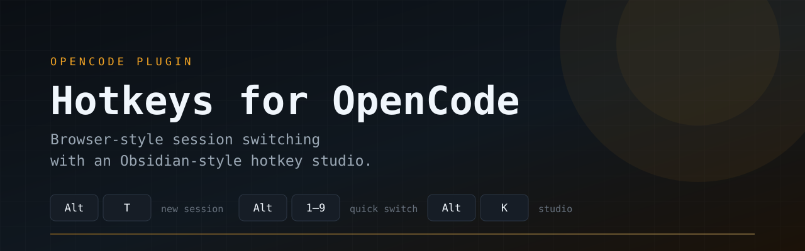
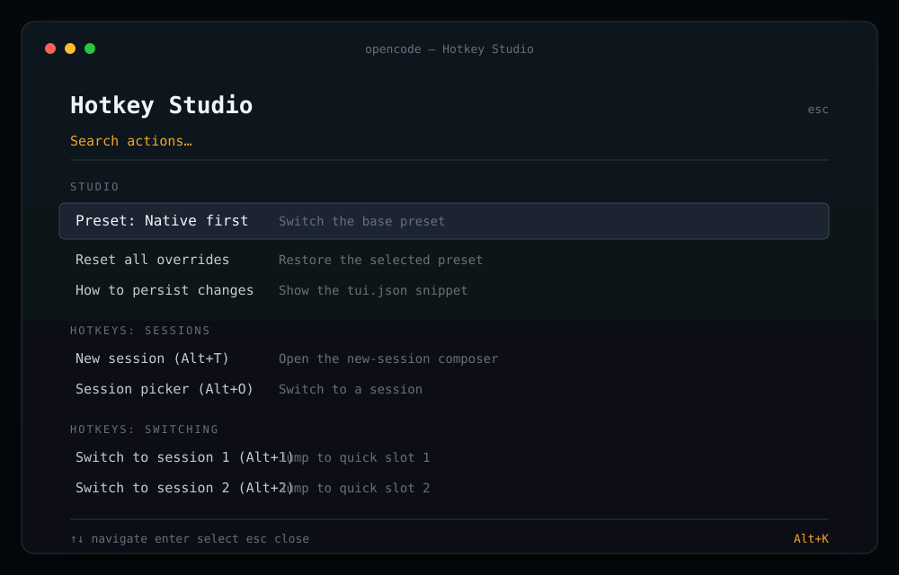

<p align="center">
  <a href="https://github.com/NarimanKhaleghi/opencode-hotkeys">
    
  </a>
</p>

<p align="center">
  <strong>Browser-style hotkeys for OpenCode Desktop. Native keys, one command, no patch.</strong>
</p>

<p align="center">
  <a href="https://github.com/NarimanKhaleghi/opencode-hotkeys/actions/workflows/ci.yml"></a>
  <a href="./LICENSE"></a>
  
  
  <a href="https://github.com/NarimanKhaleghi/opencode-hotkeys/releases/tag/v1.0.0"></a>
  <a href="https://narimankhaleghi.github.io/opencode-hotkeys/"></a>
</p>

<p align="center">
  <a href="./README.fa.md">فارسی</a> ·
  <a href="https://narimankhaleghi.github.io/opencode-hotkeys/">Documentation</a> ·
  <a href="#desktop-quick-start">Desktop install</a> ·
  <a href="#desktop-keymap">Keymap</a> ·
  <a href="#terminal-edition-tui">TUI edition</a> ·
  <a href="#troubleshooting">Troubleshooting</a>
</p>

---

**Hotkeys for OpenCode** gives OpenCode Desktop the keyboard layer you already know from a browser: new tabs, numbered tab switching, tab cycling, quick search, and settings without reaching for the mouse. The desktop installer writes the app's own keybind settings. It does not patch, wrap, or keep a background process running.

The repository also contains a separate terminal edition with presets, quick session slots, and **Hotkey Studio**. Both surfaces are documented below.

<p align="center">
  
</p>

## What's new in 1.0

Version 1.0 turns the desktop installer into a complete maintenance tool:

- `--doctor` reports installed, missing, customized, and duplicate bindings, with `--json` for scripts.
- `--backups`, `--restore <name>`, and `--prune N` make every timestamped backup manageable.
- `--diff` previews old and new bindings without writing; `--keep-custom` protects bindings you changed.
- CI now covers Linux, macOS, Windows, and the Node 20 runtime.
- Bilingual docs explain the macOS Option-key behavior and the Windows file-lock caveat.

See the [v1.0.0 release](https://github.com/NarimanKhaleghi/opencode-hotkeys/releases/tag/v1.0.0) for details.

## What you get

| Surface            | Desktop app                                   | Terminal TUI                                  |
| ------------------ | --------------------------------------------- | --------------------------------------------- |
| New tab            | `Alt+Enter`, `Alt+T`, `Mod+T`, `Mod+N`        | `Alt+T`                                       |
| Switch open tabs   | `Alt+1…9`, `Mod+1…9`                          | `Alt+1…9` quick session slots                 |
| Cycle tabs         | `Alt+PageUp/Down`, `Alt+Home/End`             | `Alt+PageUp/Down` sessions                    |
| Search             | `Alt+/`, `Alt+O`, `Mod+P`                     | `Alt+O` session picker                        |
| Settings           | `Alt+.`, `Alt+K`, `Mod+,`                     | `Alt+K` Hotkey Studio                         |
| Rebind from the UI | OpenCode's native Settings → Shortcuts        | Hotkey Studio: capture, conflict check, reset |
| Presets            | Installed defaults + native OpenCode defaults | `native`, `browser`, `notes`                  |
| Persistence        | OpenCode Desktop's own settings file          | `tui.json` + OpenCode local state             |
| Works app-wide     | While the OpenCode desktop window is focused  | While the terminal is focused                 |

`Mod` is `Ctrl` on Linux and Windows, and `Cmd` on macOS.

## Desktop quick start

### Requirements

- OpenCode Desktop **1.19 or newer**. Tested with `1.19.3` on Linux/Wayland.
- Node.js **20 or newer** for the installer.
- OpenCode Desktop has been opened at least once, so its settings file exists.

### Install with one command

Linux and macOS:

```bash
curl -fsSL https://raw.githubusercontent.com/NarimanKhaleghi/opencode-hotkeys/main/install-desktop.sh | sh
```

If you prefer to read the script before running it:

```bash
curl -fsSL https://raw.githubusercontent.com/NarimanKhaleghi/opencode-hotkeys/main/install-desktop.sh -o install-desktop.sh
sh install-desktop.sh
```

Windows PowerShell:

```powershell
irm https://raw.githubusercontent.com/NarimanKhaleghi/opencode-hotkeys/main/install-desktop.ps1 -OutFile "$env:TEMP\opencode-hotkeys.ps1"
powershell -ExecutionPolicy Bypass -File "$env:TEMP\opencode-hotkeys.ps1"
```

### Install from a clone

```bash
git clone https://github.com/NarimanKhaleghi/opencode-hotkeys.git
node opencode-hotkeys/desktop/install.mjs
```

The desktop installer has no npm dependencies. A clone is enough.

### Apply the change

Quit OpenCode Desktop completely and reopen it. Then press `Alt+Enter` to create a tab and `Alt+1` to return to the first tab.

The installer never closes or restarts the app for you. The running app reads its keybinds at startup.

### Check, inspect, or undo

```bash
node desktop/install.mjs --check
node desktop/install.mjs --print
node desktop/install.mjs --diff
node desktop/install.mjs --doctor
node desktop/install.mjs --backups
node desktop/install.mjs --uninstall
node desktop/install.mjs --restore latest
```

`--uninstall` removes only the bindings this tool installed. If you customized one of those bindings, it keeps your version and tells you which one it kept. `--restore latest` restores the newest timestamped backup next to `default.dat`.

`--doctor` reports installed, missing, and customized bindings, finds duplicate key sequences, and lists backups. Add `--json` for scripting. `--backups` lists every backup, `--prune 5` keeps the five newest, and `--keep-custom` installs only the bindings you have not customized.

## Desktop keymap

The primary shortcuts use keys whose names do not change on Persian, Arabic, or other non-Latin keyboard layouts. The Latin-letter versions and OpenCode's original defaults are kept as additional bindings.

| Action                           | Primary           | Also works                   |
| -------------------------------- | ----------------- | ---------------------------- |
| New tab (draft session)          | `Alt+Enter`       | `Alt+T`, `Mod+T`, `Mod+N`    |
| Switch to open tab 1…9           | `Alt+1…9`         | `Mod+1…9`                    |
| Previous tab                     | `Alt+PageUp`      | `Alt+Home`, `Ctrl+Shift+Tab` |
| Next tab                         | `Alt+PageDown`    | `Alt+End`, `Ctrl+Tab`        |
| Search files, commands, sessions | `Alt+/`           | `Alt+O`, `Mod+P`             |
| Open Settings                    | `Alt+.`           | `Alt+K`, `Mod+,`             |
| Close current tab                | `Mod+W`           | native default               |
| Reopen closed tab                | `Mod+Shift+T`     | native default               |
| Previous / next session          | `Alt+↑` / `Alt+↓` | native default               |

**Tabs, not history.** `Alt+1…9` switches between tabs that are currently open. To jump to any session, including one that is not open in a tab, use the search palette (`Alt+/`) and pick the session.

**Why two sets of keys?** The desktop keybind matcher compares the character produced by the key, not its physical position. On a Persian layout, `Alt+T` produces a Persian character, so `alt+t` cannot match. Digits, navigation keys, `/`, and `.` stay stable, so the installer leads with those and keeps the Latin bindings for Latin layouts.

**macOS note.** Option+letter and Option+digit may insert special characters on macOS. Use `Cmd+1…9`, `Cmd+T`, `Cmd+P`, and `Cmd+,` instead; the installer writes both sets.

## How the desktop installer works

1. Finds `default.dat` in the standard OpenCode Desktop config directory for your OS.
2. Parses the outer JSON and the app's `settings.v3` value.
3. Merges 14 keybind entries into the existing `keybinds` object.
4. Writes a timestamped backup next to the settings file.
5. Writes the new settings atomically and leaves every other preference untouched.

Settings locations:

| OS      | Default path                                                    |
| ------- | --------------------------------------------------------------- |
| Linux   | `~/.config/ai.opencode.desktop/default.dat`                     |
| macOS   | `~/Library/Application Support/ai.opencode.desktop/default.dat` |
| Windows | `%APPDATA%\ai.opencode.desktop\default.dat`                     |

The installer also checks `OpenCode` and `opencode-desktop` directory names, and honors `OPENCODE_DESKTOP_CONFIG`.

Installer options:

| Option              | Purpose                                               |
| ------------------- | ----------------------------------------------------- |
| `-c, --config PATH` | Use a specific `default.dat`                          |
| `--check`           | Exit `0` only when all managed bindings are installed |
| `--print`           | Print the managed keybind JSON                        |
| `--dry-run`         | Show changes without writing                          |
| `--diff`            | Show current and new bindings without writing         |
| `--keep-custom`     | Leave bindings you changed yourself untouched         |
| `--doctor`          | Diagnose bindings, duplicates, and backups            |
| `--json`            | Machine-readable output for `--doctor`                |
| `--backups`         | List timestamped backups                              |
| `--prune N`         | Keep the newest `N` backups and delete older ones     |
| `--uninstall`       | Remove only unmodified managed bindings               |
| `--restore PATH`    | Restore a backup by path or file name                 |
| `--restore latest`  | Restore the newest backup next to the settings file   |
| `-h, --help`        | Show help                                             |
| `-v, --version`     | Show the installer version                            |

### Manual setup

Open **Settings → Shortcuts** in OpenCode Desktop and set the visible commands by hand. Some tab commands are internal, so the installer is the only complete manual-free path.

For a manual file edit, quit the app first. Inside `default.dat`, `settings.v3` is a JSON string. Parse it, then merge these entries into its `keybinds` object:

```json
{
  "tab.new": "alt+enter,alt+t,mod+t,mod+n",
  "tab.1": "alt+1,mod+1",
  "tab.2": "alt+2,mod+2",
  "tab.3": "alt+3,mod+3",
  "tab.4": "alt+4,mod+4",
  "tab.5": "alt+5,mod+5",
  "tab.6": "alt+6,mod+6",
  "tab.7": "alt+7,mod+7",
  "tab.8": "alt+8,mod+8",
  "tab.9": "alt+9,mod+9",
  "tab.prev": "alt+pageup,alt+home,mod+option+arrowleft,ctrl+shift+tab",
  "tab.next": "alt+pagedown,alt+end,mod+option+arrowright,ctrl+tab",
  "file.open": "alt+/,alt+o,mod+p",
  "settings.open": "alt+.,alt+k,mod+comma"
}
```

On Linux and Windows, `mod` means `Ctrl`. On macOS, `mod` means `Cmd`. The desktop app accepts comma-separated alternatives for one action.

## Desktop limitations

- Shortcuts work while OpenCode Desktop is focused. This is not an OS-wide hotkey daemon.
- The desktop app does not load TUI plugins, so Hotkey Studio is not available there. Use OpenCode's native Settings → Shortcuts for further customization.
- `Alt+1…9` is a tab switcher, not a list of every session. Use `Alt+/` to search all sessions.
- Tab commands are part of OpenCode Desktop's built-in command catalog. A future upstream rename can break a binding; `--check` will report it.
- The installer edits local settings only. There is no telemetry, network call, or background process.

## Terminal edition (TUI)

The terminal plugin remains the full-featured edition: presets, quick session slots, `/keys`, and Hotkey Studio.

### Install the TUI edition

From GitHub:

```bash
git clone https://github.com/NarimanKhaleghi/opencode-hotkeys.git ~/.local/share/opencode-hotkeys
realpath ~/.local/share/opencode-hotkeys/tui.ts
```

Add the printed absolute path to `~/.config/opencode/tui.json`:

```json
{
  "$schema": "https://opencode.ai/tui.json",
  "plugin": [["/absolute/path/to/opencode-hotkeys/tui.ts", { "preset": "native" }]]
}
```

Restart the terminal OpenCode app and press `Alt+I` to confirm the plugin loaded. Use `tui.json`, not `opencode.json`.

Or run the TUI installer from the clone:

```bash
cd ~/.local/share/opencode-hotkeys
bun install
node bin/opencode-hotkeys.mjs --preset native
```

The installer keeps comments and formatting:

```bash
node bin/opencode-hotkeys.mjs --preset browser
node bin/opencode-hotkeys.mjs --bind hotkeys.new=alt+n
node bin/opencode-hotkeys.mjs --debug
node bin/opencode-hotkeys.mjs --uninstall
```

<details>
<summary><strong>Full TUI reference: presets, Studio, configuration, and troubleshooting</strong></summary>

#### Native-first preset (default)

| Shortcut       | Action                   |
| -------------- | ------------------------ |
| `Alt+T`        | New session              |
| `Alt+O`        | Session picker           |
| `Alt+PageDown` | Next session             |
| `Alt+PageUp`   | Previous session         |
| `Alt+1…9`      | Switch to quick slot 1…9 |
| `Alt+K`        | Hotkey Studio            |
| `Alt+I`        | Hotkeys help             |

#### Browser preset

| Shortcut         | Action                   |
| ---------------- | ------------------------ |
| `Ctrl+T`         | New session              |
| `Ctrl+L`         | Session picker           |
| `Ctrl+Tab`       | Next session             |
| `Ctrl+Shift+Tab` | Previous session         |
| `Ctrl+1…9`       | Switch to quick slot 1…9 |
| `Alt+K`          | Hotkey Studio            |
| `Alt+I`          | Hotkeys help             |

#### Notes preset

| Shortcut         | Action                   |
| ---------------- | ------------------------ |
| `Ctrl+N`         | New session              |
| `Ctrl+O`         | Session picker           |
| `Ctrl+Tab`       | Next session             |
| `Ctrl+Shift+Tab` | Previous session         |
| `Alt+1…9`        | Switch to quick slot 1…9 |
| `Alt+K`          | Hotkey Studio            |
| `Alt+I`          | Hotkeys help             |

#### Slash commands

| Command     | Opens          |
| ----------- | -------------- |
| `/keys`     | Hotkey Studio  |
| `/hotkeys`  | Hotkeys help   |
| `/sessions` | Session picker |

#### Hotkey Studio

Press `Alt+K` or type `/keys`.

- Search every action by title.
- Inspect the current binding and description.
- Rebind by selecting _Rebind shortcut_ and pressing the new combination.
- Clear a binding without assigning a replacement.
- Reset one action or every override back to the selected preset.
- Switch presets without editing JSON.
- See conflicts with other plugin actions and native OpenCode shortcuts before applying them.
- Copy a ready-made `tui.json` snippet from _How to persist changes_.

Studio changes apply immediately, persist in OpenCode's local state, and are restored on restart. An explicit `bindings` value in `tui.json` always wins over a stored Studio change.

#### Configuration

```json
{
  "plugin": [
    [
      "opencode-hotkeys",
      {
        "enabled": true,
        "preset": "native",
        "debug": false,
        "bindings": {
          "hotkeys.new": "alt+n",
          "hotkeys.picker": ["alt+o", "alt+p"],
          "hotkeys.doctor": false
        }
      }
    ]
  ]
}
```

| Option     | Type                               | Default    | Description                                                   |
| ---------- | ---------------------------------- | ---------- | ------------------------------------------------------------- |
| `enabled`  | boolean                            | `true`     | Keep the plugin installed but disable every shortcut.         |
| `preset`   | `"native" \| "browser" \| "notes"` | `"native"` | Base shortcut preset.                                         |
| `bindings` | object                             | `{}`       | Per-action overrides.                                         |
| `debug`    | boolean                            | `false`    | Write diagnostic markers to OpenCode's local key-value store. |

Available action ids:

```text
hotkeys.new          hotkeys.picker       hotkeys.next
hotkeys.prev         hotkeys.switch.1-9   hotkeys.studio
hotkeys.help         hotkeys.doctor
```

Comma-separated strings are accepted: `"alt+o,alt+p"`. Key names are normalized, so `Alt+T`, `alt-t`, and `Option+T` resolve to the same binding. The JSON Schema is [`schema.json`](./schema.json).

#### TUI compatibility

| OpenCode | Adapter              | Status                                                        |
| -------- | -------------------- | ------------------------------------------------------------- |
| `1.x`    | `src/adapters/v1.ts` | Tested with `1.18.23`                                         |
| `2.x`    | `src/adapters/v2.ts` | Preview adapter; core actions work, Studio is read-only in v2 |

The package ships raw TypeScript for the TUI entry, matching how OpenCode loads local TUI plugins. There are no runtime imports from `@opencode-ai/plugin` or `@opentui/*`; those packages are development-time types only.

</details>

## Troubleshooting

### Only `Alt+1…9` works on the desktop

Your keyboard layout is producing non-Latin characters for letter keys. Press `Alt+Enter` for a new tab, `Alt+PageUp/Down` to cycle, `Alt+/` for search, and `Alt+.` for settings. These are the stable bindings the installer leads with. `Alt+T`, `Alt+O`, and `Alt+K` are still present for Latin layouts.

### A desktop shortcut does nothing

1. Quit OpenCode Desktop completely, then reopen it.
2. Run `node desktop/install.mjs --check` to confirm the settings are present.
3. Make sure the desktop window is focused. These are not global shortcuts.
4. Open at least two tabs before testing `Alt+2` or `Alt+PageDown`.
5. On Windows, quit the app before installing or uninstalling so the settings file is not locked.

### The installer cannot find `default.dat`

Open OpenCode Desktop once so it creates its settings, then retry. If you use a portable or custom build, pass the path explicitly:

```bash
node desktop/install.mjs --config /path/to/default.dat
```

### The app updated and a shortcut stopped working

Run `--check`, then rerun the installer. Upstream can rename a built-in command. The installer reports missing command ids instead of silently guessing.

### `Alt` shortcuts do not arrive in the terminal TUI

- On macOS, enable **Option as Meta** (iTerm2: _Profiles → Keys → Left/Right Option key → Esc+_).
- In tmux, check whether the prefix or terminal settings consume `Alt`.
- Try a function key or `ctrl+shift+...` combination in Hotkey Studio.

### `Ctrl+Tab` or `Ctrl+1…9` do nothing in the TUI

Many terminals reserve these combinations for tab switching. Prefer the native preset or rebind those actions to `Alt` combinations.

### The TUI Studio reopened with my old shortcut

That is intentional: Studio changes are persisted in OpenCode's local state. Use _Reset to preset_ or _Reset all overrides_ to remove them. An explicit `bindings` value in `tui.json` always wins.

## Development

```bash
bun install
bun run check        # typecheck + all tests
bun run format:check
npm pack --dry-run   # inspect the package contents
```

Test coverage includes desktop settings merge, backup, dry-run, check, restore, uninstall, TUI key normalization, presets, conflict detection, session ordering, config parsing, and preset parity.

To try the TUI plugin from a checkout, point `OPENCODE_TUI_CONFIG` at a test config and list the absolute path to `tui.ts` in the `plugin` array.

## Contributing

Issues and pull requests are welcome. Run `bun run check` before opening a PR and include the OpenCode surface (Desktop or TUI), version, OS, and keyboard layout you tested.

## License

[MIT](./LICENSE) © 2026 Nariman Khaleghi

---

<p align="center">
  <sub>Not affiliated with OpenCode, Obsidian, Google, or Chrome. “Obsidian-style” describes the interaction pattern only.</sub>
</p>
